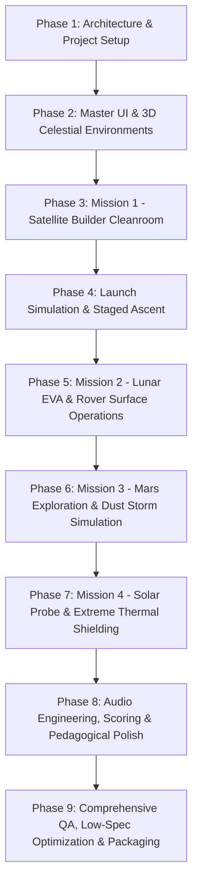

# COSMIC HORIZONS: Realistic 3D Space Exploration & Science Simulation
## Comprehensive Game Design & Technical Architecture Document (GDD / TDD)

---

### Executive Vision & Pedagogical Philosophy
*Cosmic Horizons* is a fully 3D, standalone educational space simulation game engineered for middle-school students (specifically 8th-standard / ages 13–15). It combines the satisfying modular customization of vehicle builder simulators (*Car Mechanic / Car For Sale*) with the scientific authenticity and awe of space exploration (*Kerbal Space Program*, NASA missions).

The game operates strictly as a native, compiled 3D executable—delivering realistic physically based rendering (PBR), atmospheric scattering, orbital motion, and interactive vehicle construction without looking like a web app, a 2D flashcard tool, or pixelated blocks.

---

## 1. Engine Evaluation & Final Recommendation

| Engine | License & Cost | 3D Graphics Capability | Low-Spec Performance | Learning Curve | Suitability Score | Verdict |
| :--- | :--- | :--- | :--- | :--- | :--- | :--- |
| **Godot 4.3 LTS** | **MIT (100% Free & Open Source)** | High (Vulkan Forward+, PBR, SDFGI, Volumetric Fog) | **Exceptional** (Runs on Intel UHD 620+) | Moderate (Clean GDScript / Node Tree) | **9.8 / 10** | **SELECTED ENGINE** |
| **Unreal Engine 5** | Free up to $1M rev (Custom EULA) | Ultra (Nanite, Lumen) | **Unusable** on school laptops | High / Steep C++ / Blueprints | 4.5 / 10 | Rejected (Massive 100GB install, requires RTX GPU) |
| **Unity 6** | Closed Source (Freemium/Runtime fees) | High (URP / HDRP) | Moderate | Moderate (C#) | 6.0 / 10 | Rejected (Telemetry, closed license, corporate baggage) |
| **Bevy / Raylib** | MIT / Zlib | Medium (Code-first) | High | Very High (No 3D visual scene editor) | 3.5 / 10 | Rejected (Impractical for student 3D assembly & animations) |

### Why Godot 4.3 is the Optimal Engine:
1. **Zero Financial or Legal Risk**: MIT License permits total freedom for schools, non-profits, or commercial distribution with zero royalties, zero subscription fees, and no account requirements.
2. **Ultra-Lightweight Footprint**: The entire Godot editor is a single ~120 MB executable that launches in 2 seconds and can run off a USB flash drive.
3. **Hardware Accessibility**: Features a dual renderer: **Forward+** (for desktop PCs with dedicated GPUs) and **Compatibility / Mobile** (OpenGL 3.3 / Vulkan Mobile, running smoothly at 60 FPS on integrated Intel Iris/UHD graphics).
4. **Node & Scene Tree Architecture**: Godot’s nested scene architecture perfectly mirrors space mission hierarchies (e.g., `Rocket` $\rightarrow$ `Stage1`, `Stage2`, `Fairing`, `SatelliteAdapter` $\rightarrow$ `PlayerSatellite`).

---

## 2. Complete Technical Architecture

### 2.1 Core System Architecture Diagram

```
+-----------------------------------------------------------------------------------+
|                                  AUTOLOADS / CORE                                 |
|  +------------------------+  +-------------------------+  +--------------------+  |
|  |     GameManager.gd     |  |     AudioManager.gd     |  |   Progression.gd   |  |
|  | - Mission State Tracker|  | - Space Ambiance & SFX  |  | - Budget & Scores  |  |
|  | - Active Payload Data |  | - Countdown Voice/Audio |  | - Unlocked Badges  |  |
|  +------------------------+  +-------------------------+  +--------------------+  |
+-----------------------------------------------------------------------------------+
                                         |
                                         v
+-----------------------------------------------------------------------------------+
|                               MISSION SCENE PIPELINE                              |
|                                                                                   |
|  +--------------------+      +--------------------+      +---------------------+  |
|  |   SATELLITE LAB    | ---> |    LAUNCH TOWER    | ---> |    ORBIT / SURFACE  |  |
|  |  (3D Assembly Bay) |      | (Ascent & Staging) |      | (Science Execution) |  |
|  +--------------------+      +--------------------+      +---------------------+  |
|            |                           |                            |             |
|            v                           v                            v             |
|    - 3D Socket Snapping       - Atmospheric Drag           - Orbital Mechanics    |
|    - Mass & Power Budget      - Multistage Separation      - Surface EVA / Rover  |
|    - Thermal Shield Check     - Orbital Insertion Burn     - Sample Spectrometry  |
+-----------------------------------------------------------------------------------+
                                         |
                                         v
+-----------------------------------------------------------------------------------+
|                               DEBRIEF & RESULTS HUD                               |
|       Scientific Data Yield  |  Budget Efficiency  |  Accuracy  |  Badges         |
+-----------------------------------------------------------------------------------+
```

### 2.2 Scene Hierarchy & Data Models

#### A. Satellite Assembly Data Model (`SpacecraftPart.gd`)
A custom Godot `Resource` class that drives the "Car Mechanic" style assembly:
```gdscript
class_name SpacecraftPart
extends Resource

enum Category { CHASSIS, SOLAR_PANEL, ANTENNA, CAMERA, INSTRUMENT, BATTERY, THERMAL_SHIELD, PROPULSION }

@export var part_id: String
@export var part_name: String
@export_multiline var description_simple: String # 8th-grade friendly language
@export var category: Category
@export var cost_credits: int
@export var mass_kg: float
@export var power_draw_w: float    # Positive for consumers, negative for generators (e.g. solar)
@export var thermal_rating_k: float # Max temperature tolerance in Kelvin
@export var science_yield: int
@export var mesh_scene: PackedScene # 3D model with connection socket metadata
```

#### B. Rocket Flight & Staging Subsystem
Instead of intractable raw N-body calculus, the physics uses a semi-analytic Patched Conics & Dynamic Aerodynamic model:
- **Atmospheric Drag Equation**:
  $$F_d = \frac{1}{2} \rho(h) \cdot v^2 \cdot C_d \cdot A$$
  Where $\rho(h) = \rho_0 \cdot e^{-h / H}$ (barometric density falloff with scale height $H = 8500\text{ m}$).
- **Interactive Staging Sequence**:
  1. **T-0**: Main Engine Ignition (Solid Rocket Boosters + Liquid Core).
  2. **Max-Q**: Atmospheric peak dynamic pressure indication (vibration/sound effect).
  3. **Stage 1 MECO** (Main Engine Cut-Off): Booster burnout.
  4. **Staging Event 1**: Decoupler explosive separation impulses stage downward; Stage 2 Vacuum Engine ignites.
  5. **Fairing Jettison**: At $h > 100\text{ km}$ (Kármán line), atmospheric friction is negligible; fairing halves blow apart with dual lateral impulse vectors, revealing the student's custom satellite.
  6. **Orbital Insertion Burn**: Circularizing velocity ($v \approx 7800\text{ m/s}$) into target Earth, Lunar-transfer, or Mars-transfer orbit.

---

## 3. Recommended Development Tools

| Tool | Official Website | Direct Download | Cost & License | Open Source? | Educational / Commercial Permitted? | Hardware Requirements |
| :--- | :--- | :--- | :--- | :--- | :--- | :--- |
| **Godot 4.3 Engine** | [godotengine.org](https://godotengine.org) | [godotengine.org/download](https://godotengine.org/download) | 100% Free (MIT) | **Yes** | **Yes** (Unrestricted) | 2-core CPU, 4GB RAM, OpenGL 3.3 / Vulkan GPU |
| **Blender 4.2 LTS** | [blender.org](https://www.blender.org) | [blender.org/download](https://www.blender.org/download) | 100% Free (GPL) | **Yes** | **Yes** (Unrestricted) | 64-bit 4-core CPU, 8GB RAM, OpenGL 4.3 GPU |
| **Material Maker** | [materialmaker.org](https://www.materialmaker.org) | [materialmaker.itch.io](https://rodzill4.itch.io/material-maker) | 100% Free (MIT) | **Yes** | **Yes** (Unrestricted) | Built on Godot, runs on any modern PC |
| **GIMP 2.10** | [gimp.org](https://www.gimp.org) | [gimp.org/downloads](https://www.gimp.org/downloads) | 100% Free (GPLv3) | **Yes** | **Yes** (Unrestricted) | 2-core CPU, 2GB RAM |
| **Audacity 3.6** | [audacityteam.org](https://www.audacityteam.org) | [audacityteam.org/download](https://www.audacityteam.org/download) | 100% Free (GPLv2/v3) | **Yes** | **Yes** (Unrestricted) | 1GHz CPU, 2GB RAM |
| **VS Code / VSCodium** | [vscodium.com](https://vscodium.com) | [vscodium.com/#install](https://vscodium.com/#install) | 100% Free (MIT) | **Yes** | **Yes** (Unrestricted) | 1GHz CPU, 4GB RAM |

---

## 4. Legitimate Free & Open Asset Repositories

### 4.1 Planetary Textures & Scientific Datasets
1. **NASA Scientific Visualization Studio (SVS)**:
   - *URL*: [svs.gsfc.nasa.gov](https://svs.gsfc.nasa.gov)
   - *Content*: True-color Blue Marble Earth maps, Lunar Reconnaissance Orbiter (LRO) elevation displacement maps, Mars MOLA topographical data.
   - *License*: Public Domain (US Government work). Free for educational and commercial use.
2. **Solar System Scope Textures**:
   - *URL*: [solarsystemscope.com/textures](https://www.solarsystemscope.com/textures/)
   - *Content*: 2K, 4K, and 8K ultra-clean spherical unwrapped textures of Earth, Moon, Mars, Sun, and Milky Way starfield.
   - *License*: Creative Commons Attribution 4.0 International (CC-BY 4.0).
3. **USGS Astrogeology Science Center**:
   - *URL*: [astrogeology.usgs.gov](https://astrogeology.usgs.gov)
   - *Content*: High-resolution elevation maps for Apollo landing sites, Gale crater, and Olympus Mons.
   - *License*: Public Domain.

### 4.2 Spacecraft, Rover & Astronaut 3D Models
1. **NASA 3D Resources Catalog**:
   - *URL*: [nasa3d.arc.nasa.gov](https://nasa3d.arc.nasa.gov)
   - *Content*: Official NASA GLTF/OBJ 3D models: Curiosity Rover, Perseverance, Apollo Lunar Module, Saturn V, Space Launch System (SLS), Parker Solar Probe, James Webb Space Telescope.
   - *License*: Public Domain / Educational Fair Use.
2. **Kenney Space Kit & UI Pack**:
   - *URL*: [kenney.nl/assets](https://kenney.nl/assets)
   - *Content*: Modular satellite bodies, solar panels, thrusters, sci-fi UI panels, crosshairs, gauges.
   - *License*: CC0 1.0 Universal (Public Domain). No attribution required.
3. **Poly Haven**:
   - *URL*: [polyhaven.com](https://polyhaven.com)
   - *Content*: 100% CC0 PBR textures (Martian dust, lunar basalt rock, solar cell reflections, gold foil insulation).

### 4.3 Audio & Space Soundscapes
1. **NASA Audio Collection (Archive.org)**:
   - *URL*: [archive.org/details/nasaaudio](https://archive.org/details/nasaaudio)
   - *Content*: Authentic Apollo countdown audio ("10, 9, ignition sequence starts..."), Neil Armstrong radio transmissions, rocket telemetry tones.
   - *License*: Public Domain.
2. **Freesound.org**:
   - *URL*: [freesound.org](https://freesound.org)
   - *Content*: Rocket exhaust rumble, pneumatic stage release pops, servo motors, atmospheric wind roar.
   - *License*: Filter by CC0 / Public Domain.

---

## 5. Hardware Specifications & Target Performance

### Target: Playable 60 FPS on Average Classroom & Home PCs
- **Minimum Specifications (Target: 720p 30-45 FPS)**:
  - OS: Windows 10/11 64-bit
  - CPU: Intel Core i3-4130 / AMD FX-4300 (or equivalent dual-core 2.4 GHz)
  - RAM: 4 GB
  - GPU: Intel HD Graphics 4400 / UHD 620 (with Vulkan/OpenGL 3.3 support)
  - Storage: 1.5 GB available space
- **Recommended Specifications (Target: 1080p 60 FPS)**:
  - OS: Windows 10/11 64-bit
  - CPU: Intel Core i5 8th Gen / AMD Ryzen 5 2600
  - RAM: 8 GB
  - GPU: NVIDIA GTX 1050 / AMD RX 560 or better
  - Storage: 3 GB SSD

---

## 6. Estimated Development Difficulty & Team Workload Breakdown

For a small student team / indie developer, the estimated project size is **Medium-High (180–240 hours total)**.

| Subsystem | Complexity | Estimated Effort | Key Simplifications for Middle Schoolers |
| :--- | :--- | :--- | :--- |
| **Modular Satellite Garage** | Medium | 30 hours | Fixed 3D snap sockets on chassis rather than arbitrary free-floating collision hulls. |
| **Rocket Flight & Staging** | Medium-Low | 25 hours | 2.5D or stabilized 3D trajectory with auto-gravity turn and simplified thrust controls. |
| **Earth Orbit Operations** | Low | 15 hours | Reticle lock-on photography & scanning mini-games with simplified false-color filters. |
| **Moon EVA & Rover** | Medium | 35 hours | Simplified 1/6th gravity ragdoll-bouncy walk controller; stable 6-wheel rover suspension. |
| **Mars Exploration** | Medium | 35 hours | Crater boundary terrain with rock collision; laser spectrometer mini-game (element matching). |
| **Sun Solar Shielding** | Medium-Low | 20 hours | Distance-based thermal flux; orientation indicator (keep shield facing Sun vector). |
| **UI, Tutorials & Audio** | Low | 20 hours | Visual icons, large readable fonts, audio cues, and step-by-step interactive arrows. |

---

## 7. Step-by-Step Development Roadmap (Phases 1 to 9)



- **Phase 1: Architecture & Foundation**: Setup Godot 4.3 project structure, import base assets, create `GameManager` Autoload, define `SpacecraftPart` resources.
- **Phase 2: Environment Creation**: Shader-based planetary bodies (Atmospheric Rayleigh scattering for Earth, Cratered Moon, Oxidized Mars, Glowing Solar Corona with coronal mass ejections).
- **Phase 3: Earth Mission & Customizer**: 3D assembly cleanroom with orbital camera, part catalog UI, live stat calculation (Mass, Power, Thermal, Budget).
- **Phase 4: Rocket Selection & Launch Simulation**: Rocket catalog, multi-stage launch pad simulation with interactive countdown, throttle control, staging triggers, and orbital insertion cutscene.
- **Phase 5: Moon Mission**: Lunar descent thruster control, surface landing, Mode A (Astronaut EVA with 1.62 m/s² gravity, soil sampling), Mode B (Rover exploration, solar recharging).
- **Phase 6: Mars Mission**: Red planet descent with heat shield & sky-crane, surface navigation through Jezero Crater, dust storm survival mechanics, drill spectrometer analysis.
- **Phase 7: Sun Mission**: Extreme environment probe design, high-temperature heat shield mechanics, proximity perihelion navigation, solar flare imaging.
- **Phase 8: Educational Polish, Badges & Audio**: Speech synthesis/voice lines for objectives, educational tooltips, badge awards, celebratory score screen.
- **Phase 9: Performance Optimization & Testing**: LOD implementation, occlusion culling, profile on low-end Intel iGPU, package into standalone zero-install Windows `.exe`.

---

## 8. Major Technical Challenges & Educational Solutions

### Challenge 1: The Astronomical Scale Problem
*Problem*: In reality, Earth's radius is $6,371\text{ km}$, and the Sun is $149,600,000\text{ km}$ away. Rendering real 1:1 scale causes floating-point precision jitter (Z-fighting and vertex distortion) in 32-bit game engines.
*Solution*: **Dual-Domain Coordinate Scaling**.
- The game uses a 1:1 local physics domain for spacecraft and astronauts (1 unit = 1 meter).
- Celestial bodies use a logarithmic visual domain: Planets are rendered at 1:10,000 scale with scaled visual distance, projected via a skybox backdrop camera layer. When landing, the game transitions seamlessly into a high-detail localized surface chunk ($2\text{ km} \times 2\text{ km}$).

### Challenge 2: Orbital Mechanics vs. Middle-School Accessibility
*Problem*: Real orbital maneuvers (Hohmann transfer orbits, retrograde burns to lower periapsis) are counter-intuitive and frustrate young students.
*Solution*: **Flight Vector Assist HUD**.
- The HUD displays clear visual indicators: a Green Prograde ring ("Speed Up to Go Higher"), a Red Retrograde ring ("Slow Down to Descend"), and a blue "Target Orbit" guide ribbon.
- The physics engine provides "SAS Stability Assist" (automatic gyro dampening) so spacecraft do not tumble uncontrollably.

### Challenge 3: Realistic Terrain on Modest School Hardware
*Problem*: High-poly terrain meshes with 8K textures can cause memory spikes and frame drops on school computers without discrete graphics.
*Solution*: **Baked Heightmap Meshes + Multi-Texture Blending**.
- Lunar and Martian terrains use 3D meshes pre-baked in Blender with 3 levels of detail (LOD).
- Surface detail uses efficient GPU triplanar textures (seamless rock, fine dust) that look hyper-realistic up close with low VRAM footprint (<500 MB).

### Challenge 4: Car-Mechanic Style Modular Assembly in 3D
*Problem*: If components can be attached anywhere, players can produce floating or clipping components that break physics and look unnatural.
*Solution*: **Typed Socket Hardpoints**.
- Each chassis features specific visual attachment nodes (`Socket_Solar_Left`, `Socket_Solar_Right`, `Socket_Antenna_Top`, `Socket_Payload_Front`).
- Snapping is instantaneous with an audible mechanical click, particle dust puff, and smooth rotational alignment tween.
